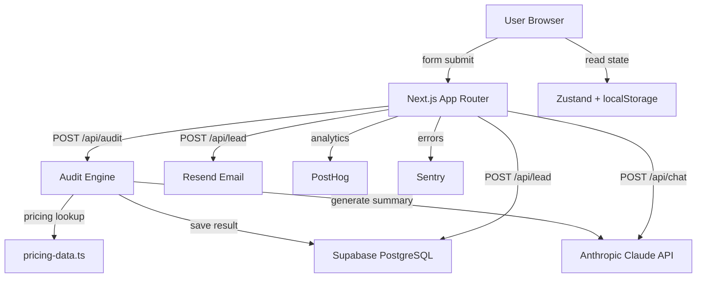

# Architecture — Credex AI Spend Audit

## System Diagram



## Data Flow

1. **Form submit** → `POST /api/audit` → `runAudit(formData)` → per-tool recommendations
2. **Claude enrichment** → 100-word summary appended to result (optional, graceful degradation)
3. **Result stored** in Zustand store → rendered in `ResultsDashboard`
4. **Lead capture** → Supabase `leads` table + Resend transactional email
5. **Chatbot** → `POST /api/chat` → Claude with system context → displayed in chat window

## Scaling for 10k Requests/Day

- **Stateless API routes** → horizontal scaling on Vercel Edge
- **Rate limiting** → replace in-memory `Map` with Upstash Redis (`@upstash/ratelimit`)
- **Supabase** → add read replica for analytics queries
- **Claude API** → add request queuing with p-queue to respect rate limits
- **CDN** → static assets cached on Vercel Edge Network globally
- **Audit engine** → pure CPU, scales with serverless function concurrency

## File Structure

```
src/
  app/
    page.tsx              — Main page (hero + form + results)
    layout.tsx            — Root layout with metadata + effects
    globals.css           — Design system CSS
    api/
      audit/route.ts      — POST: run audit engine
      chat/route.ts       — POST: chatbot (Claude)
      lead/route.ts       — POST: lead capture
      health/route.ts     — GET: uptime check
  components/
    effects/CustomCursor.tsx   — Custom cursor + sparkle
    form/SpendForm.tsx         — Tool input form
    results/ResultsDashboard.tsx — Savings dashboard
    chatbot/Chatbot.tsx        — Floating orb + chat
  lib/
    audit-engine.ts       — Core audit logic
    pricing-data.ts       — Tool pricing in ₹
    currency.ts           — INR formatting utilities
  store/
    auditStore.ts         — Zustand store (persisted)
```
